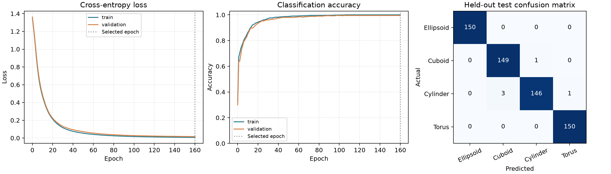

# Reference experiment evaluation

All numbers below are computed from the saved reference model. This is a single-seed synthetic-data experiment, not a real-world benchmark.

## Setup

Architecture: 24 → 48 → 48 → 4. Parameters: 3748. SGD learning rate 0.03; batch size 64; 160 epochs; seed 42; L2 weight decay 0.0001. Validation-selected epoch: 160.

| Model / split | N | Loss | Accuracy | Macro F1 |
|---|---:|---:|---:|---:|
| MLP / train | 1600 | 0.007425 | 100.0000% | 1.000000 |
| MLP / validation | 400 | 0.016175 | 99.5000% | 0.995000 |
| MLP / test | 600 | 0.023375 | 99.1667% | 0.991649 |
| Logistic regression / train | 1600 | 0.045992 | 98.9375% | 0.989337 |
| Logistic regression / validation | 400 | 0.065008 | 98.0000% | 0.979962 |
| Logistic regression / test | 600 | 0.041002 | 98.5000% | 0.984965 |

## Test confusion matrix (actual rows, predicted columns)

| | Ellipsoid | Cuboid | Cylinder | Torus |
|---|---:|---:|---:|---:|
| Ellipsoid | 150 | 0 | 0 | 0 |
| Cuboid | 0 | 149 | 1 | 0 |
| Cylinder | 0 | 3 | 146 | 1 |
| Torus | 0 | 0 | 0 | 150 |

## Evidence of optimization

Initial train loss: 1.355270. Final train loss: 0.007425. Parameter-change L2 norm: 6.177727. The epoch log records positive gradient norms.

## Interpretation and limits

The MLP makes 5 errors versus 9 for validation-tuned logistic regression: 0.8333% versus 1.5000% test error. The 0.6667 percentage-point accuracy improvement is descriptive, not a claim of statistical significance. Most mistakes confuse cylinders with cuboids. Aggregate descriptors can overlap under variation in proportions; examining individual error meshes is future work.

Both methods use the same area-sampled geometry features, train-only scaler, balanced independent splits and validation selection. No test data are used for weight updates or epoch/C selection. Demo objects have separate generation seeds. The submitted configuration was trained once before viewing the reported test scores; no test-directed reference-model tuning was performed.

Real research scans, novel categories, multi-object meshes, partial surfaces and substantial noise are outside this evaluation. Softmax probabilities have not been calibrated. Repeated GUI experiments expose the fixed test set, so later research should use a fresh final holdout.

## Reproducibility

Feature archive SHA-256: `8b8963873e8ec2616df835760b042cbb18d0690d5e3f9251e796e6e676c40c21`.

`data/manifest.json` stores independent object seeds and geometry hashes. `requirements-lock.txt` records the tested dependency versions. Regenerate and train using the README commands. `model.pt` includes weights and training-only normalization. `metrics.json` contains the full epoch history and baseline validation search.

