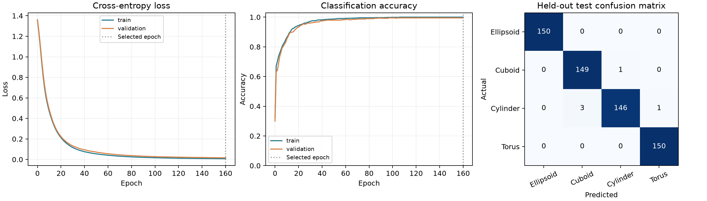
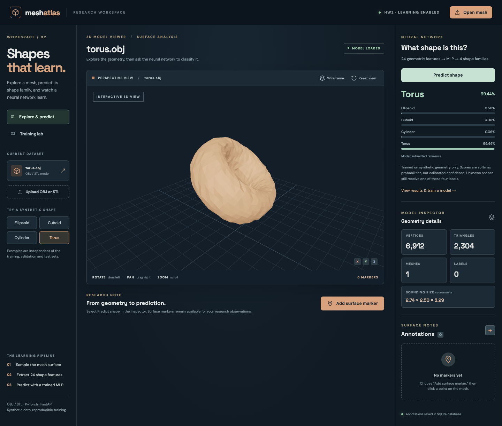
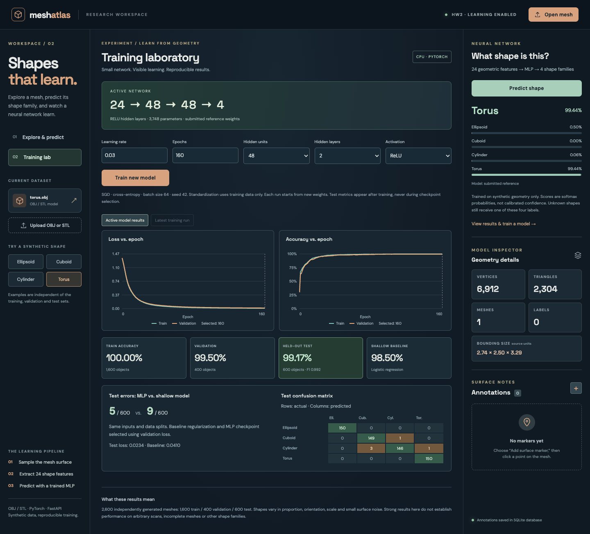

# Mesh Atlas — DS7400 HW2: Shapes That Learn

Mesh Atlas extends the **HW1 3D mesh viewer** into a working learning application:

**OBJ/STL mesh → surface sampling → 24 geometric features → PyTorch MLP → prediction in React.**

Select a bundled shape or open an OBJ/STL file, click **Predict shape**, and see the predicted family and all four probabilities. No notebook or separate inference script is needed. The **Training lab** also lets you change hyperparameters, watch actual training/validation curves, evaluate the completed run, and activate its weights.

## Results from the included reference weights

The fixed synthetic dataset contains **2,600 independent objects**, balanced across **Ellipsoid, Cuboid, Cylinder, Torus**. Shapes vary in aspect ratio, rotation, translation, uniform scale and small vertex noise. Objects are generated separately for each split, not split as different views of the same object.

| Model | Train accuracy (1,600) | Validation accuracy (400) | Test accuracy (600) | Test errors | Test cross-entropy | Test macro F1 |
|---|---:|---:|---:|---:|---:|---:|
| MLP, 24 → 48 → 48 → 4 | 100.00% | 99.50% | **99.17%** | **5 / 600** | 0.02338 | 0.99165 |
| Multinomial logistic regression | 98.94% | 98.00% | 98.50% | 9 / 600 | 0.04100 | 0.98497 |

The MLP has a lower observed test error than the shallow benchmark on this split. The difference is **four objects (0.67 percentage points)**; this one run does not establish a statistically reliable advantage on new distributions. Both models receive the same standardized features and the same splits. Logistic regression is optimized with L-BFGS and its regularization `C` is selected from `[0.01, 0.1, 1, 10, 100]` using validation loss; selected `C=10`.



The exact results, epoch history, baseline search, data checksum and parameter-change evidence are in [`artifacts/reference/metrics.json`](artifacts/reference/metrics.json). Trained weights **are included** in [`artifacts/reference/model.pt`](artifacts/reference/model.pt). See [the detailed evaluation](EVALUATION.md).

## Run locally

Requirements: **Python 3.10+**, **Node.js 20.19+ or 22.12+**, npm. The checked environment used Python 3.12 on macOS/Apple Silicon and CPU PyTorch. No GPU, external dataset, cloud account or paid service is required.

From this repository folder, install once:

```bash
python3 -m venv .venv
source .venv/bin/activate
pip install -r backend/requirements.txt
npm ci
```

On Windows, activate with `.venv\Scripts\activate`. `requirements-lock.txt` records the exact Python packages used for this submission; the bounded requirements above are more portable across supported Python/platform versions.

Then start both servers with one command:

```bash
npm start
```

Open **http://localhost:5173**. Stop both services with Ctrl+C. API documentation: **http://localhost:8000/docs**. The included trained model loads automatically; initial training is unnecessary.

Alternatively, run the services separately, from the repository root:

```bash
.venv/bin/python -m uvicorn backend.app:app --host 127.0.0.1 --port 8000
npm run dev -- --host 127.0.0.1 --port 5173
```

`docker compose up --build` is an optional backend-only alternative; run `npm run dev` for the frontend. Docker configuration is provided but was not executed for this submission. Vite proxies `/api` requests to port 8000. `npm run build` validates the production bundle; a production host must supply the same API proxy. This is a local course demo, not an authenticated public training service.

## Try it

1. In **Explore & predict**, choose **Torus**, rotate the 3D view, and click **Predict shape**. The API receives triangle coordinates, never the filename or the example label.
2. Try **Ellipsoid**, **Cuboid**, and **Cylinder**. The examples were generated with seeds outside all dataset splits.
3. Open `public/examples/cuboid.stl` to demonstrate binary STL upload, or open your own OBJ/STL. Predictions support up to 100,000 triangles. Uploaded research meshes can be outside the training distribution.
4. Open **Training lab**. Inspect the actual train/validation curves, test accuracy, baseline and confusion matrix.
5. Change learning rate, epochs, hidden units, hidden layers or activation; click **Train new model**. The CPU job runs in the background; the UI polls real metrics every 150 ms. A small run may finish in a few seconds. Only one training job runs at a time; it can be cancelled.
6. Test metrics appear only after the validation-selected checkpoint is restored. Click **Use trained model for predictions**, return to the viewer and predict again. **Restore reference model** returns to the submitted model. The reference weights are never overwritten by GUI experiments.
7. **Add surface marker**, click the mesh, enter a title/label/note and save. Reopen the same named file to retrieve the marker from SQLite.

## Model and training, explained

The model is a small feed-forward MLP with **two hidden ReLU layers of 48 units** and **3,748 trainable parameters**. Its 24 inputs describe geometry rather than mesh topology or vertex count:

- 3 normalized covariance eigenvalues;
- 9 quantiles (10th through 90th percentile) of distance from the sampled centroid;
- 3 fourth standardized moments along principal axes;
- 9 quantiles of pairwise surface-point distances.

`training/features.py` samples **1,024 points uniformly by triangle area** using barycentric coordinates, centers the points, and normalizes by RMS radius. Area sampling avoids learning tessellation density. The descriptors are invariant to global translation, uniform scale and rotation for a fixed set of sampled surface points. Finite sampling, remeshing and near-equal eigenvalues can still perturb features. They do not retain full mesh topology.

The scaler mean and standard deviation are fitted on **training objects only** and are saved with the checkpoint. Training and inference call the same preprocessing function. The network returns four logits; cross-entropy applies log-softmax internally. Softmax is applied for display only at inference.

The explicit loop in `training/train.py` performs:

```python
optimizer.zero_grad()
logits = model(batch_features)       # forward propagation
loss = criterion(logits, labels)     # cross-entropy
loss.backward()                     # backpropagation / parameter gradients
optimizer.step()                    # gradient descent parameter update
```

The reference run uses mini-batch **SGD**, learning rate **0.03**, batch size **64**, weight decay **0.0001**, seed **42**, and **160 epochs**. There is no momentum. Each epoch records full training and validation loss/accuracy; the lowest validation loss selects the checkpoint (epoch 160 in this run). The test set is evaluated after this selection and never supplies gradients. Epoch zero records the untrained model. Parameter change L2 is 6.1777, with positive gradient norms and decreasing loss, confirming actual learning.

The MLP was chosen because nonlinear combinations of compact shape descriptors can distinguish overlapping shape families while remaining small enough to understand and retrain on a CPU. A raw-point architecture such as PointNet would be a reasonable later extension, but is not implemented or claimed here.

## Reproduce the experiment

The ready-to-use feature dataset is included in `data/features.npz`; `data/manifest.json` records labels, per-split sizes, generator seed ranges and geometry hashes. Raw synthetic meshes can be regenerated from their seeds, so thousands of OBJ files need not be committed.

```bash
# Optional: regenerate features and five independent demonstration files.
.venv/bin/python -m training.dataset

# Recreate reference weights, metrics and plot (overwrites reference artifacts).
.venv/bin/python -m training.train

# A separate experiment, preserving the reference artifacts:
.venv/bin/python -m training.train --epochs 80 --hidden-units 32 --hidden-layers 1 --activation tanh --output artifacts/runs/manual
```

GUI runs save weights and metrics under `artifacts/runs/<run-id>/` (Git-ignored). The active model and live job registry are local to the server process; restarting selects the reference model. Results shown for repeated GUI runs reuse the fixed test set for teaching, so do not optimize hyperparameters by repeatedly inspecting test accuracy. Use validation metrics to choose settings and obtain a fresh test set for a future research claim.

## HW1 features retained

- **Visualization:** OBJ and ASCII/binary STL meshes; orbit, pan, zoom, reset, wireframe; mesh/triangle counts and bounding size.
- **Annotation:** yes — typed surface markers with title, notes and deletion; the neural network does not use these annotations as training labels.
- **Backend:** yes — FastAPI hosts model inference, training jobs and annotation APIs.
- **Database:** yes — SQLite stores dataset metadata and annotations; model checkpoints and training reports are filesystem artifacts. If the annotation API is unavailable, the viewer uses browser storage. Neural-network prediction requires the backend and does not fabricate a fallback result.
- **Privacy:** files are parsed in the browser. On prediction, triangle coordinates are sent to the local backend for computation, but not stored there; filenames and manual annotations are not classifier inputs. The repository contains only synthetic examples, features and weights.

## Interface





## Files and libraries

| Path | Purpose |
|---|---|
| `src/App.jsx`, `src/mesh.js` | HW1 viewer, selection, OBJ/STL parsing and triangle extraction |
| `src/Learning.jsx` | Predictions, hyperparameters, live curves, metrics and model switching |
| `backend/app.py` | FastAPI and SQLite annotations |
| `backend/learning.py` | Geometry inference and background training API |
| `training/model.py` | Small PyTorch MLP |
| `training/features.py`, `training/dataset.py` | Shared preprocessing and reproducible synthetic generator |
| `training/train.py` | Explicit training, shallow benchmark, evaluation, weights and plots |
| `artifacts/reference/` | Included checkpoint, measurements and scientific plot |
| `data/`, `public/examples/` | Fixed feature splits and unseen demo OBJ/STL meshes |
| `scripts/test_e2e.mjs` | Live browser integration checks |
| `scripts/record_demo.mjs` | Actual browser demo recorder with timed captions |

Major libraries: **React, Vite, Three.js, React Three Fiber, Drei, FastAPI, SQLite, PyTorch, NumPy, trimesh, scikit-learn, matplotlib**. Playwright is used for browser verification and demo recording.

## Verification

```bash
.venv/bin/python -m unittest discover -s backend -v
npm run build
npm audit
# With both servers running; Google Chrome is the default on macOS:
npm run test:e2e
```

For another Chrome installation, set `CHROME_PATH`; on Linux the script can use a Playwright-managed Chromium after `npx playwright install chromium`.

Tests cover split independence, train-only normalization, regeneration and transformation invariance, actual OBJ/STL predictions, malformed inputs, training/activation/cancellation, reference checkpoint preservation, database persistence, all four browser predictions, a misleading upload filename, mobile overflow and visible API failure. The build may report the expected large Three.js bundle warning.

## Limitations

These are easy, procedural shape families, not real-world object recognition or validated defect detection. Most test mistakes are cylinders confused with cuboids. Partial scans, multiple objects, novel shapes and severe mesh noise are untested. The model always returns one of four labels; a high softmax score is not calibrated certainty or proof that an object is in distribution. A feature-range warning is only a heuristic. Adding new classes requires labeled data and retraining. The synthetic examples are deliberately disclosed rather than presented as research scans.

## References and AI disclosure

- [Rumelhart, Hinton & Williams (1986), *Learning representations by back-propagating errors*](https://www.nature.com/articles/323533a0): foundational backpropagation reference.
- [PyTorch, *Optimizing Model Parameters*](https://docs.pytorch.org/tutorials/beginner/basics/optimization_tutorial.html): reference for the forward/loss/backward/SGD loop.
- [PyTorch neural network documentation](https://docs.pytorch.org/docs/stable/nn.html), [trimesh documentation](https://trimesh.org/), [scikit-learn LogisticRegression](https://scikit-learn.org/stable/modules/generated/sklearn.linear_model.LogisticRegression.html).

**AI assistance disclosure:** OpenAI Codex assisted with synthetic data generation, implementation, tests, interface integration, documentation and demo preparation. The application extends the author's HW1 Mesh Atlas code. No external pretrained model was used. The training follows the standard PyTorch tutorial pattern; the project-specific feature extraction, generator, MLP service and UI were implemented with AI assistance. The optional video narration is computer-generated. The student must independently review the code and references and be able to explain the model and training process. A Chinese study guide is in [MODEL_GUIDE_ZH.md](MODEL_GUIDE_ZH.md).

## Submission

Submit a GitHub repository link and the live demo video (under three minutes) to Canvas. [DEMO_SCRIPT.md](DEMO_SCRIPT.md) describes the walkthrough, including both optional challenges. This repository contains source code, reproducible data, trained weights and measured results. Creating these materials does not itself submit the assignment to Canvas.
